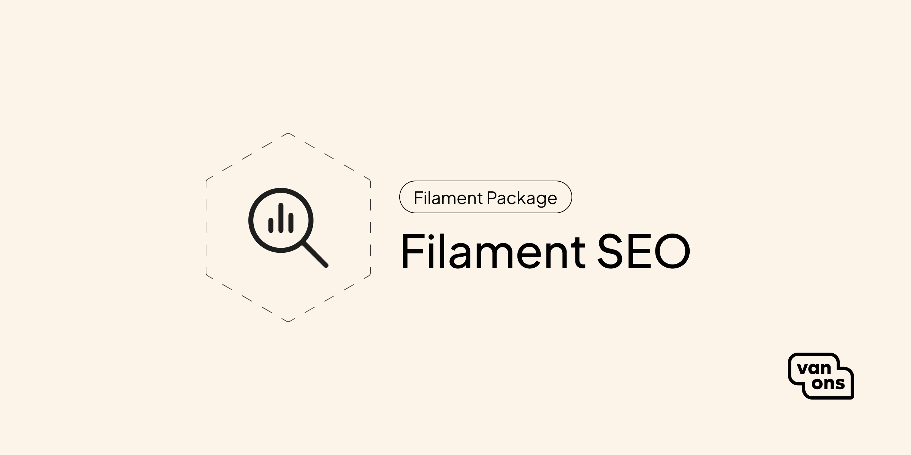

<p align="center"></p>

# Filament SEO

[](https://github.com/VanOns/filament-seo/actions/workflows/run-tests.yml)
[](https://packagist.org/packages/van-ons/filament-seo)
[](LICENSE.md)

Add SEO management to your Filament admin panel — meta tags, SEO analysis, AI-generated metadata, and sitemaps.

## Quick start

> For Filament version compatibility, see [Compatibility](docs/compatibility.md).

### Installation

```bash
composer require van-ons/filament-seo
```

### Model preparation

Add a `seo` column to your model's table:

```php
Schema::table('pages', function (Blueprint $table) {
    $table->json('seo')->nullable();
});
```

Implement the `Seoable` contract on your model:

```php
use VanOns\FilamentSeo\Concerns\HasSeoFields;
use VanOns\FilamentSeo\Contracts\Seoable;

class Page extends Model implements Seoable
{
    use HasSeoFields;

    public function url(): string
    {
        return route('page.show', $this);
    }
}
```

### Add fields to your Filament resource

```php
Filament\Forms\Components\Tabs\Tab::make('seo')
    ->schema(App\Models\Page::getSeoFields()),
```

### Add the view to your layout

```blade
<x-filament-seo::head />
```

## Documentation

Please see the [documentation](docs) for detailed information about installation and usage.

## Contributing

Please see [Contributing](CONTRIBUTING.md) for more information about how you can contribute.

## Testing

```bash
composer test
```

## Changelog

Please see [Changelog](CHANGELOG.md) for more information about what has changed recently.

## Upgrading

Please see [Upgrading](UPGRADING.md) for more information about how to upgrade.

## Security

Please see [Security](SECURITY.md) for more information about how we deal with security.

## Credits

We would like to thank the following contributors for their contributions to this project:

- [All contributors](../../contributors)

## License

The scripts and documentation in this project are released under the [MIT License](LICENSE.md).

---

<p align="center"><a href="https://van-ons.nl/" target="_blank"></a></p>
